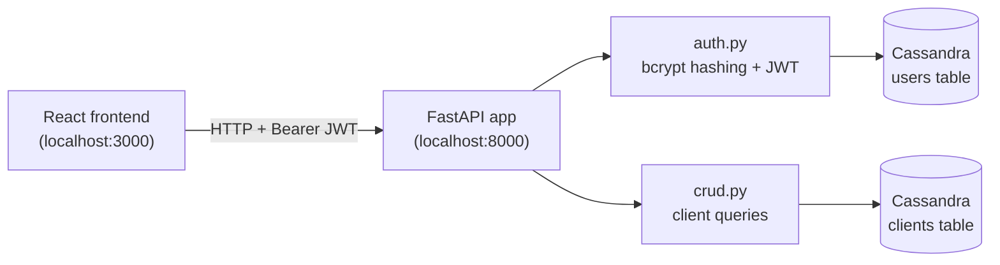

# ManaiBay

A small client-management app: a React + Material UI frontend on top of a FastAPI CRUD API with JWT authentication and Apache Cassandra storage.

## Features

- User registration and login (`/register`, `/login`); passwords are hashed with bcrypt
- JWT bearer tokens (HS256, 30-minute expiry) protect every `/clients` endpoint
- Client CRUD: create, list, get by ID, update and delete clients (name + email)
- React UI with login/register screens, a client form (create and edit) and a client table with edit/delete actions
- The token is kept in `localStorage` and attached to API requests automatically
- `users` and `clients` tables are created on demand if they do not exist
- Interactive API docs from FastAPI at `http://localhost:8000/docs`

## Tech stack

| Layer    | Technology |
|----------|------------|
| Frontend | React 19, Material UI 7, Axios, Create React App (`react-scripts` 5) |
| API      | Python, FastAPI, Uvicorn, Pydantic, passlib (bcrypt), python-jose (JWT) |
| Database | Apache Cassandra 3.11 (via `cassandra-driver`), run with Docker Compose |

## Architecture



```
ManaiBay/
├── manai_bay_crud_api/        # FastAPI backend
│   ├── main.py                # App, routes, CORS
│   ├── auth.py                # Password hashing, JWT creation/validation
│   ├── crud.py                # Client CRUD queries
│   ├── database.py            # Cassandra session dependency + table creation
│   ├── config.py              # Cassandra settings from environment
│   ├── schemas.py / models.py # Pydantic models
│   ├── requirements.txt
│   ├── .env.example
│   └── docker-compose.yml     # Local Cassandra
└── manai_bay_crud_frontend/   # React app (Create React App)
    └── src/
        ├── api/clientApi.js   # Axios instance + API helpers
        ├── App.js
        └── components/        # LoginForm, RegisterForm, ClientForm, ClientList
```

## API endpoints

| Method | Path                  | Auth | Description              |
|--------|-----------------------|------|--------------------------|
| POST   | `/register`           | No   | Register `{email, password}` |
| POST   | `/login`              | No   | Returns `{access_token, token_type}` |
| POST   | `/clients/`           | Yes  | Create a client `{name, email}` |
| GET    | `/clients/`           | Yes  | List all clients         |
| GET    | `/clients/{client_id}`| Yes  | Get one client           |
| PUT    | `/clients/{client_id}`| Yes  | Update a client          |
| DELETE | `/clients/{client_id}`| Yes  | Delete a client          |

`/login` expects a JSON body (`{"email": ..., "password": ...}`), not an OAuth2 form.

## Prerequisites

- Python 3.10 or 3.11 (the code uses `X | None` type hints)
- Node.js 18+ and npm
- Docker (for the local Cassandra instance)

## Getting started

### 1. Start Cassandra

```bash
cd manai_bay_crud_api
docker compose up -d
```

Cassandra can take a minute to accept connections. The keyspace is not created automatically, so create it once:

```bash
docker exec -it cassandra cqlsh -e "CREATE KEYSPACE IF NOT EXISTS clientkeyspace WITH replication = {'class': 'SimpleStrategy', 'replication_factor': 1};"
```

The `users` and `clients` tables are created by the API on first request.

### 2. Run the API

```bash
cd manai_bay_crud_api
python -m venv .venv
source .venv/bin/activate        # Windows: .venv\Scripts\activate
pip install -r requirements.txt

export SECRET_KEY="$(python -c 'import secrets; print(secrets.token_urlsafe(32))')"
# PowerShell: $env:SECRET_KEY = python -c "import secrets; print(secrets.token_urlsafe(32))"

uvicorn main:app --reload --port 8000
```

Open `http://localhost:8000/docs` to explore the API.

### 3. Run the frontend

```bash
cd manai_bay_crud_frontend
npm install
npm start
```

The app opens at `http://localhost:3000`. Register an account, log in, then manage clients.

To create a production build: `npm run build`.

## Configuration

The API reads its settings from environment variables. `manai_bay_crud_api/.env.example` lists them; the app does not load `.env` files on its own, so export the variables in your shell (or use your process manager / container environment).

| Variable                   | Default                | Description |
|----------------------------|------------------------|-------------|
| `SECRET_KEY`               | `your-secret-key` (dev fallback) | Key used to sign JWTs. **Set this to a long random value outside local development.** If unset, an insecure, publicly known fallback is used. |
| `CASSANDRA_CONTACT_POINTS` | `127.0.0.1`            | Comma-separated Cassandra hosts |
| `CASSANDRA_KEYSPACE`       | `clientkeyspace`       | Keyspace to use (must exist) |

Frontend: the API base URL is set in `manai_bay_crud_frontend/src/api/clientApi.js` (`http://localhost:8000`).

## Security notes

- CORS currently allows all origins (`allow_origins=["*"]` in `main.py`); restrict it before deploying.
- Tokens are stored in `localStorage`.
